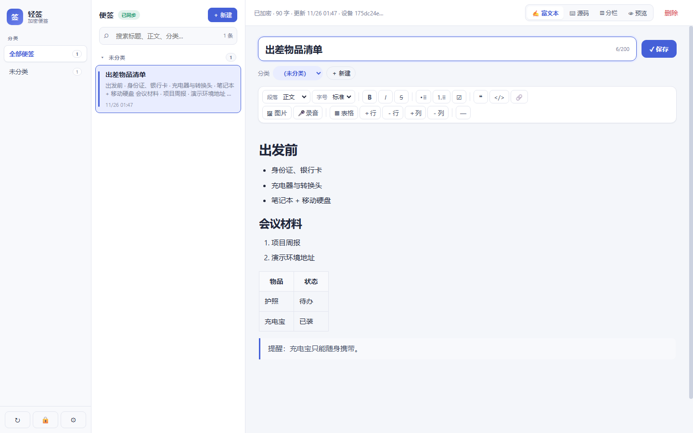
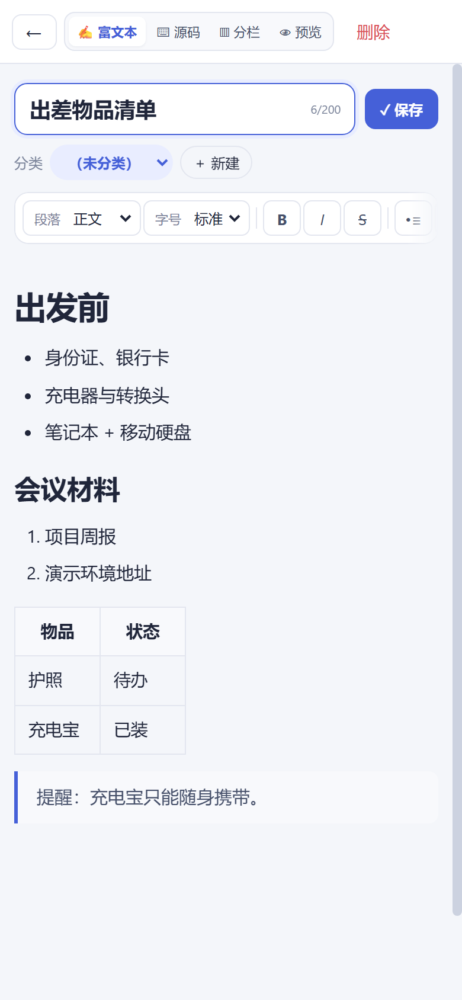

# 轻签 · NasNotes

[](https://github.com/jikun2025/nas-notes/actions/workflows/ci.yml)
[](LICENSE)

后端 Python 3.9+ 标准库 · 前端零依赖 PWA · 端到端加密 · AGPL-3.0

一个为个人 NAS 设计的轻量加密便签：单容器后端 + PWA 前端，浏览器和安卓手机都能读写、离线编辑与同步，全文搜索在本地明文内存中完成。服务端与手机缓存只保存 AES-GCM 密文，不保存明文，也不保存加密口令。

适合记录账号、密码提示、配置片段、临时备忘等短文本，可在正文中插入图片并附带语音。**它不是多用户协作知识库，也没有版本历史和多级文件夹；富文本模式覆盖标题、加粗、列表、引用、表格、图片等常用排版，不做精细字处理。**





## 首次启动与默认账户

- **发布版不含任何账户、便签或备份**：仓库里没有数据库，镜像首次启动只会建一个空库。
- 首次启动自动创建默认账户 **admin / admin**（可用 `NOTES_USER` / `NOTES_PASS` 覆盖，**仅首次建库生效**，之后再改 .env 无效）；服务端日志会打印 `已创建默认账户 admin / admin`。
- ⚠️ **登录后第一件事是改账户与口令**：口令同时用于包裹加密库密钥（wkey），改密会原子重包裹，旧口令立即失效。留着 admin/admin，等于把库的钥匙挂在门上。
- **升级不会重置**：已有 `data/notes.db` 的实例升级到 v2.6 仍是原来的账户与数据，不会出现 admin/admin。
- **要清空数据**（从零开始）：「设置 → 数据与备份 → 清空数据」，需手动输入「清空数据」确认；或 `DELETE /api/vault` 带 `{"confirm":"RESET"}`。它删除 `vault` 与**全部便签**，`accounts` 表不动（账户保留），同时 `epoch + 1` 让各客户端下次同步自动全量对齐。连账户一起重置只能停服后删除 `data/notes.db` 再启动，不可恢复。
- 完整发布说明见 [RELEASE_NOTES.md](RELEASE_NOTES.md)。

## 获取

直连仓库：

```bash
git clone https://github.com/jikun2025/nas-notes.git
```

国内网络可用加速前缀或镜像（前缀方式把原地址整段接在后面，任选一个能通的）：

```bash
# 加速前缀（推荐，跟随官方仓库，不用等镜像同步）
git clone https://ghfast.top/https://github.com/jikun2025/nas-notes.git
git clone https://ghproxy.net/https://github.com/jikun2025/nas-notes.git
git clone https://gh-proxy.com/https://github.com/jikun2025/nas-notes.git

# 镜像站
git clone https://github.kkgithub.com/jikun2025/nas-notes.git
```

安卓 APK 挂在 Releases：从 [Releases](https://github.com/jikun2025/nas-notes/releases) 下载 `nas-notes-shell-v3.0.apk`；下载慢时同样加前缀：

```
https://ghfast.top/https://github.com/jikun2025/nas-notes/releases/download/v3.0/nas-notes-shell-v3.0.apk
```

> 手机壳 v3.0 起**应用内没有密码**：门禁交给手机锁屏/指纹/人脸，本机加密库由原生设备密钥自动包裹，打开即用；旧版本用密码建的库会在首次启动时让你输一次旧密码完成迁移。要连 NAS 时打开「设置 → 连接服务器」填地址、账户、密码（HTTPS 自签服务可在同一页导入自家 CA 证书），密码只存原生沙箱、不进网页存储。

> 「设置 → 连接服务器」里的地址示例只是占位，请填你自己的 `NAS_IP:端口`；填过一次会存进原生配置。更推荐从源码自己 `gradle assembleRelease` 打包，签名在你手里。

## 功能

- **NAS Web UI**：三区布局（分类栏 / 便签列表 / 编辑预览区，借鉴 Joplin 的信息层级）；四种视图可随时切换——**富文本**（默认，直接看排版，不显示 Markdown 符号）/ 源码 / 分栏 / 预览。
- **窄屏/手机布局**：分类栏不消失，而是收成**可滑出的抽屉**——列表头「☰」打开，点遮罩、×、选中分类或进入便签都会收起；同步 `↻`、锁定 `🔒`、设置 `⚙` 三个入口在抽屉底部，手机上也点得到。顶部（列表头、编辑区头、登录卡片）按系统栏安全区自动让位，状态栏与手势条不会压住按钮。
- **便签快捷操作**：列表项右键（手机长按）可打开、调整分类或删除；分类可新建/改名/删除，分类栏右键（手机长按）同样能改名或删除——没有便签的空分类也能留下并随时清理。分类清单与便签一样用保险库密钥加密后存本机（IndexedDB），换设备时按便签里带的分类名自动重建。
- **编辑区头部**：标题框内嵌字数计数（`n/200`），右侧「✓ 保存」可立即加密落盘并触发一次同步；分类以胶囊标签显示，便于一眼看清归档位置。
- **固定编辑头**：标题、分类、排版工具栏固定在编辑区顶部（不随正文滚动），长文滑到中段也能直接点工具；只有正文区域滚动，滚动时固定条会浮起一层淡投影作提示。
- **编辑工具栏**：桌面两行分组——上行「段落 / 字号」下拉加加粗、斜体、删除线、列表、待办、引用、代码、链接，下行插入图片/录音、表格与行列调整、分隔线；手机上合并为一行，可左右滑动（右缘渐隐提示）。
- **编辑工具栏行为**：富文本下点「B」就是真加粗、选「段落：标题 2」就是真标题，正文里不会冒出 `**` `#`；源码模式下则是 Markdown 快捷排版。表格一键插入并可在富文本里直接增删行列（不依赖弹窗），编辑区字号即时切换，源码与渲染结果分栏时滚动联动。
- **设置与主题**：两级设置（账户 / 同步 / 外观与编辑 / 数据与备份 / 关于）；内容区在对话框内独立滚动，标题栏与「保存设置」始终可见，长面板在手机上也不会被裁掉；浅色/深色主题与编辑字号只存本机。
- **安卓 APK（离线独立）**：内置界面与数据库都在手机上，**不连 NAS 也能创建本机加密库、读写、搜索、看图听录音**；与 NAS 的同步默认「手动」——只有点顶部状态胶囊（或设置里的「立即同步」）才联网，不会在后台自动上传。
- **端到端加密**：PBKDF2-HMAC-SHA256（310,000 次迭代）派生密钥，AES-256-GCM 加密标题+正文；每条便签独立随机 IV。
- **离线优先**：修改一律先加密写入本机 IndexedDB 并进入待同步队列；同步可选自动或手动，服务端与客户端均用「最后写入时间 + 设备标识」做确定性冲突裁决。同步前先校验两端是同一套加密库，密钥不同就停手，绝不互相覆盖。
- **图片与录音**：图片直接插入正文光标位置（自适应压缩、点击放大、可单独删除），录音以低码率单声道 Opus 加密片段显示在正文下方；两者与正文一起 AES-GCM 加密，服务端只收到密文。设置中可选三档压缩强度，NAS 与手机端共用同一套逻辑。
- **全局搜索**：解锁后在本地明文内存里匹配标题、正文和图片文件名，断网同样可用；服务端不提供明文搜索接口。
- **加密备份**：Web UI 一键导出/导入加密 JSON 备份，备份文件不含明文（包含正文图片与录音密文）。
- **零运行时依赖**：后端只用 Python 标准库，前端无框架、无 CDN、无第三方脚本。

## 快速开始（Docker / 飞牛 NAS）

1. 复制本仓库到 NAS，例如 `/vol1/1000/docker/nas-notes`。
2. 启动：

   ```bash
   docker compose up -d --build
   ```

3. 浏览器打开 `http://NAS_IP:28080`，像普通服务一样用默认账户名 **admin**、密码 **admin** 登录（可在 `.env` 里用 `NOTES_USER` / `NOTES_PASS` 指定初始账户，仅首次建库时生效）。登录后立即在「设置」里修改账户名和密码——密码同时用于解锁加密库。（宿主端口为 28080——NAS 上 8080 已被 reader 容器占用；容器内仍是 8080。）
4. 首次进入会要求创建加密库（或自动迁移旧版加密库），确认后即可使用。

飞牛 NAS 用户也可以使用图形界面：Docker → Compose → 新增项目 → 项目路径选择该目录 → 创建项目。

**升级已有部署**：`server.py` 是打进镜像的（不是挂载），所以每次升级都要 `docker compose build && docker compose up -d`；只重建容器不会换代码。升级前先备份 `data/notes.db`。从 v2.5 及更早升到 v2.6 时，服务端会就地为 `notes` 表补 `rev` 列并回填历史条目，数据与 `vault` 不受影响；客户端（浏览器 PWA 强刷 / 手机换 APK）可以晚一步升级，老客户端不带 `since` 时服务端仍按全量返回。

### 手机端（安卓）

1. **必须先配置 HTTPS**。`http://NAS_IP:28080` 下 Service Worker 和 WebCrypto 不可用，PWA 无法离线。推荐用飞牛自带反向代理 + 域名证书，或 Nginx Proxy Manager / Caddy，把 HTTPS 域名反代到容器 `8080` 端口（即宿主 `28080`）。
2. 安卓 Chrome 打开 HTTPS 域名，菜单 →「添加到主屏幕」。
3. 首次在线打开，用与 NAS 端相同的账户口令登录并解锁加密库，完成一次同步。
4. 之后断网也能打开、编辑、搜索；自动模式下恢复网络后会同步，手动模式下点「同步」按钮即可。
> iOS 同样支持添加到主屏幕，但本文只验证了安卓路径。

### 安卓 APK 壳（`android/` 目录，免 HTTPS）

不想给 NAS 配 HTTPS 反代时，可以用仓库自带的原生 APK 壳（`android/`，纯 Java、零第三方依赖、仅平台内置 API）：

- 前端与 PWA **共用同一份 `static/`**（Gradle 直接把仓库根目录的 `static/` 挂为 assets），代码零复制零改动；壳里仅额外注入一个 `assets/_bridge.js`（劫持 `fetch('/api/*')` → 原生转发、blob 下载 → 原生保存、把 NAS 地址输入框注入「设置 → 同步」面板）。
- 页面挂在 WebView 虚拟安全域 `https://appassets.androidplatform.net/` 下，`crypto.subtle`、IndexedDB、localStorage 全部可用——**APK 不要求 NAS 提供 HTTPS**；原生层只转发密文，不接触明文。
- 加载有两层：先走虚拟域（`loadUrl`，origin 最标准）；若主文档没拿到或首屏 2.2 秒后仍是空白，自动降级为「CSS/JS 全部内联进 HTML + `loadDataWithBaseURL`」——有些 WebView/安卓兼容层（例如鸿蒙上的安卓运行环境）不回调 `shouldInterceptRequest`，静态资源会全 404。降级后只有 `/api/` 需要网络，走原生桥。
- **两条路径都必须注入壳标记与 `_bridge.js`**（Java 里统一走 `injectShellScripts()`）：虚拟域路径下首页是由拦截器返回的，若原样吐 assets 里的 `index.html`，`fetch('/api/*')` 会落到静态资源拦截器上拿到 `502 Bridge Unavailable`，而且 `__NN_SHELL__` 缺失会让同步模式退回「自动」。
- 真出现白屏时，屏幕上会直接摊开诊断信息（WebView 包名与版本、UA、错误级控制台输出），截图即可定位，不用盲猜。
- **系统栏安全区**：`targetSdk 35` 起安卓强制 edge-to-edge，WebView 会画到状态栏/手势条下面。原生层把真实 insets 写成 CSS 变量（`--nn-safe-top/bottom/left/right`），页面用 `var(--safe-top)` 消费，头部与底部自动让位；浏览器直连时同一套变量退化为 `env(safe-area-inset-*)`，两条路径都不用写死数值。
- 壳内不注册 Service Worker（资源已内联，没有需要缓存的网络请求）。
- **离线独立**：App 打开即可用，启动不请求 NAS。首次可点「仅在本机使用」用当前密码建本机加密库（不联网），之后也能正常读写、搜索、看图听录音。
- **手动同步**：壳内同步方式默认「手动」。列表顶部那颗状态胶囊既是状态（离线可用 / 待同步 N / 已同步 时间），也是同步入口——点了才弹「连接 NAS」，输了账户密码才联网。
- 导入加密备份同样是纯本机操作，断网也能恢复；条目进待同步队列，等下次手动同步再推给 NAS。
- **NAS 地址在登录页填**：APK 第一次打开就能看到「NAS 地址」输入框（只写 `IP:端口` 也行，自动补 `http://`），旁边有「测试」按钮先验连通；点登录会先把地址存进原生 SharedPreferences，再向该地址发登录请求。登录后也可在「设置 → 同步 → NAS 服务器地址」里改，换端口/域名不必重新打包。
- 加密备份导出改存到系统「下载/NasNotes」目录；文件选择（插图/导入）与录音麦克风权限走原生桥接。
- 安装包只有 ~95 KB 是正常的：它是 WebView 壳，不含浏览器内核、Node 或任何运行时，界面全部是仓库里的静态文件。

构建（需 JDK 17 + Android SDK platform 35 / build-tools 35.0.0，注意 `JAVA_HOME` 必须指向 JDK 17）：

```bash
cd android
sdkmanager "platforms;android-35" "build-tools;35.0.0"   # 已装可跳过
keytool -genkeypair -keystore nasnotes-release.jks -alias nasnotes -keyalg RSA -keysize 2048 -validity 10000 \
  -storepass <密码> -keypass <密码> -dname "CN=NasNotes Shell, OU=local, O=nas-notes, C=CN"
# 生成 keystore.properties（storeFile/storePassword/keyAlias/keyPassword 四行）
gradle assembleRelease
# 产物：app/build/outputs/apk/release/app-release.apk
```

把 APK 传到手机安装即可（自签名，需允许「安装未知应用」）。`keystore.properties` 与 `*.jks` 已被 gitignore，密钥请自行备份——丢失后无法用同一签名升级。

## 安全模型

| 位置 | 保存内容 |
| --- | --- |
| NAS SQLite (`data/notes.db`) | 仅 IV + AES-GCM 密文（正文 HTML 内嵌图片、录音片段）、时间戳、设备标识、删除标记；账户表只存登录凭证的 PBKDF2 哈希与盐，无明文口令；无 `title` / `body` 列 |
| 浏览器 IndexedDB | 仅密文便签（含图片/录音密文）、待同步队列、加密库 salt/wrapped（wkey 的密文包裹） |
| localStorage | 会话令牌（服务端签发、重启失效）、设备标识、压缩档位、同步方式与间隔（不存口令） |
| 浏览器内存 | 解锁期间的 wkey/CryptoKey 与明文便签 Map；锁定/刷新/关闭页面即清除 |

- **普通账户登录**：登录框只有账户名和密码（默认 admin/admin），不依赖 WebCrypto 或弹窗，局域网 HTTP 与安卓 WebView 下都能稳定登录。服务端把密码用 PBKDF2（200,000 次迭代 + 随机盐）哈希后入库，明文不落盘、不进日志。
- 加密库用随机 wkey（AES-256-GCM）加密便签；wkey 由 `AES-GCM(KDF(密码, salt, 310k), wkey)` 包裹存入 vault.wrapped。修改密码只换包裹层，wkey 不变、笔记密文无需重加密。服务端解不开 wkey，就无法解密任何笔记。
- 密码丢失且无备份时无法自行恢复。登录页「忘记密码？」只是一个逃生口：展开后会明确提示**将永久删除服务器和本机上的全部便签、图片和录音**，必须手动输入「清空数据」才会执行；它**不会修改账户名和密码**，执行后重新登录会创建新的空加密库。也可用加密备份恢复数据。
- 登录失败按 IP 限速（60 秒内 8 次失败即临时封禁 429）；改名/改密后旧会话令牌全部撤销。
- **密码丢失且无备份时无法恢复数据**；请写入密码管理器并单独保存加密备份。
- 从「口令直加密」的旧版加密库升级时，首次解锁会尝试用登录密码静默迁移：本机解密全部便签、生成随机 wkey 重加密、原子替换服务端 vault 包裹；迁移不弹 `window.prompt`（安卓 WebView 默认不支持）。升级时还会自动删除旧版可能存过明文的 SQLite 表并打印警告。

### 图片与录音

- 图片：点「🖼 在正文中插入图片」选图，会插入到正文光标位置，不再堆在便签底部。浏览器内优先编码为 WebP（不支持时回退 JPEG），按「缩放边长 × 质量」迭代压缩到目标体积，结果比固定质量更省空间。支持 JPG/PNG/WebP/GIF；GIF 无法无损保帧压缩，限制 2 MB。
- 文字保护：会粗略识别文字/截图类图片（大面积纯色 + 高频边缘），这类图片强制保留至少 1280 px 边长和更高质量，避免小字糊掉。
- 压缩档位（设置里选，仅影响之后新增的附件）：

  | 档位 | 图片目标体积 | 最长边 | 录音码率 |
  | --- | --- | --- | --- |
  | 清晰 | ≤ 700 KB | 1920 px | 64 kbps |
  | 均衡（默认） | ≤ 320 KB | 1440 px | 32 kbps |
  | 极小 | ≤ 140 KB | 1024 px | 20 kbps |

- 图片预览/删除：点击正文图片放大查看，右上角 `✕` 删除单张；图片文件名纳入全局搜索。
- 录音：强制单声道 + 回声消除/降噪，按所选码率用 MediaRecorder 录制 Opus/webm（兼容 mp4/ogg），单条最长 5 分钟。插入后提示压缩后大小，音频卡片也显示实际体积。
- 图片和录音都以 base64 随正文 JSON 一起加密，单条便签明文上限 8 MB，服务端密文上限 12 MB（请求体 14 MB），单条便签最多 20 段录音。
- 旧版便签中作为底部附件存在的图片，在解锁时会自动迁移为正文内联图片并在下次保存时落盘，无需手工处理。
- 预览/播放使用 `data:` URL，明文只在解锁后的浏览器内存中；锁定、刷新或关闭页面即清除，Service Worker 不缓存 API 响应。

### 双端同步

两端是同一套前端逻辑：本地先写密文，再由用户（或自动模式）决定何时与 NAS 对齐。

1. **本地写入**：编辑后先在浏览器/WebView 内加密，写入 IndexedDB 的 `notes`，同时向 `outbox` 追加一条操作（新增/删除）；明文只进入内存缓存。
2. **推送**：按入队顺序把 `outbox` 逐条提交到服务端。服务端用「最后写入时间 + 设备标识」裁决，返回最终版本；客户端用返回结果覆盖本地、解密进内存并清除该条队列。
3. **拉取（增量）**：`GET /api/notes?since=<rev>` 只取上次同步后发生变化的行（含删除墓碑），按 `rev` 分页；跳过仍有本地待推送操作的条目，只在服务端版本更新时覆盖本地并解密。首次同步或游标失效时 `since=0` 自动走分页全量。
4. **冲突**：时间相同按设备标识字典序裁决；冲突时以服务端版本为准并提示。没有字段级合并，同一条便签并发编辑会有一方被覆盖。

**同步方式**（设置 → 同步，配置只存本机）：

| 模式 | 谁用 | 触发时机 |
| --- | --- | --- |
| 手动（安卓壳默认） | 手机 App | **只有**点列表顶部的状态胶囊 / 侧栏 `↻` / 设置里的「立即同步」 |
| 自动（浏览器默认） | NAS Web 页 | 解锁、编辑后 0.3 秒、恢复联网、回到前台，以及按自定义间隔定时触发 |

- 手动模式下，启动、写便签、切网络、恢复联网都**不发任何请求**；顶部胶囊显示「离线可用」或「待同步 N」。
- 手动同步第一次会弹出「连接 NAS」小窗输入账户密码；成功后本次进程内不再重复输入，令牌失效时再点一次会重新弹出。
- 自动间隔可填 10～86400 秒（默认 60 秒），超出范围会提示并自动收敛；锁屏、离线或页面隐藏时跳过。
- 两种模式的加密、冲突裁决、备份格式完全相同，差异只在「什么时候发起同步」。

**增量同步协议**（v2.6 起，服务端与客户端需一起升级）：

- 服务端每次写入/删除都分配一个**单调递增的 `rev`**（存 `sync_state.notes_rev`，与客户端时钟无关）。客户端时钟回拨、同一毫秒多条写入、`updated_at` 相同按 device 裁决这几种情况，用时间戳做 `since` 都会漏数据，所以改用服务端序号。
- 响应 `{notes, serverTime, rev, epoch, partial, nextSince}`：`partial=true` 时客户端用 `nextSince` 继续拉下一页（单页最多 400 条 / 约 4 MB），`partial=false` 时把 `rev` 落盘为本机游标。
- 本机游标只存 `{rev, epoch, salt}` 三字段到 IndexedDB `meta`，**不含任何明文**；`salt` 或 `epoch` 变化（改口令、服务器清空重建）立即强制全量。
- 删除是墓碑（`deleted=1` 且分配新 rev），增量同步同样能拉到删除事件。
- **冲突裁决不变**：仍是 last-write-wins + 时间戳相同时按 `device` 字典序，服务端 `is_newer` 与客户端 `isNewer` 完全一致；`rev` 只用于分页与游标，**绝不参与裁决**。
- 兼容：不带 `?since=` 的老客户端仍拿到一次性全量列表；老服务端（响应无 `rev`/`nextSince`）会让新客户端自动退化为「一次全量、不写游标」，不会失效。
- 实测（`tools/test_incremental_sync.py`，416 条便签）：全量响应 **89,402 B**，无变更时增量响应 **115 B**（约 1/777）。5000 条库全量约 10.7 MB，日常同步不再重复搬运整个库。

### 全文索引与数据结构

v2.6 起搜索不再每次遍历全部便签、重新解析 Markdown。

- **内存态倒排索引** `static/nn-index.js`（零依赖、纯 ES5）：解锁后由已解密的 `plainCache` 构建，把「标题 + 正文纯文本 + 分类 + 附件名」切成中文友好的 bigram（二元组）与单字，建立 `bigram → 便签 id` 倒排表；同时维护 `分类 → id` 倒排表。
- 搜索时先用连续 bigram 的交集取候选集（**包含即召回，不会漏检**），再用与改造前完全一致的各字段 `includes()` 精确校验一次，消除跨位置假阳性。1000 条便签 / 200 组随机查询的对照测试（`tools/test_search_index.js`）结果集与全量扫描完全一致。
- 分类切换从 O(n) 全量扫描降为 O(该分类条数)；无搜索词时完全不解析正文。
- **明文索引绝不落盘**：只在解锁期间存在于内存，不写 IndexedDB、outbox、备份，也不发给服务端；`lockApp()` / `clearLocalNotes()` 立即销毁。服务端仍无法做明文全文搜索，索引本质只是「搜索缓存」。
- 索引随单条增删改**增量维护**，不必重建；正在编辑、还没到 450 ms 自动保存的那条会在搜索前单独刷新，保证刚打的字立刻能搜到。
- **存储层优化**：`notesCache` 本来就是 `id → 密文` 的 Map；新增 `idbPutMany()` 用单事务批量写，导入备份与增量拉取不再为每条便签各开一个事务。同步游标、分类清单 `folderRegistry` 都只存元数据，不含明文。

### 离线独立的账户与密钥

- 加密库的 `salt` 与 `wrapped`（用密码包裹的 wkey）会在首次解锁后缓存进本机 IndexedDB，之后**只用密码即可离线解锁**，不依赖服务端。
- 手机首次启动可选「仅在本机使用」：本机生成 salt + 随机 wkey 并建立空库，完全不联网；这类库带 `local_only` 标记。
- 之后第一次连接 NAS 手动同步时，会把本机包裹层上传（`PUT /api/meta`），服务器从此接管这套密钥，离线攒下的便签一并推送。
- 如果服务器上已存在**另一套**加密库（密钥不同），同步会直接停下并提示，不会覆盖任何一边；要改用服务器库必须先导出本机备份。
- 「锁定」只清内存明文与密钥，不再撤销会话，所以解锁后可以直接同步，不必重新输密码。

### 容量与性能边界（实测）

APK 只有约 110 KB，因为它是**一个 WebView 壳 + 约 320 KB 未压缩的纯文本源码**（HTML / CSS / JS / 图标），不含浏览器内核、不含任何第三方 SDK、不含原生 `.so` 库；压缩后约 109 KB。功能相近的商业笔记 App 动辄几十 MB，主要来自内置渲染引擎/编辑器框架、React Native 或 Flutter 运行时、统计/推送/登录 SDK、多套分辨率资源与字体。

轻量化不等于不可靠，但确实有边界。用真实 Chromium + 真实 `server.py` 压测（`node tools/test_scale.js`，结果写入 `.tmp/scale-results.json`）：

| 便签数 | 冷启动解密 | 列表渲染（优化前） | 列表渲染（现在） | 搜索一次（现在） | 单条保存 | 列表 DOM 节点 |
| --- | --- | --- | --- | --- | --- | --- |
| 1,000 | 7 ms | 49 ms | 9 ms | 16 ms | 0.6 ms | 819（只渲染前 200 条） |
| 3,000 | 23 ms | 136 ms | 9 ms | 30 ms | 0.5 ms | 819（只渲染前 200 条） |

- **加密与单条写入不随数据量变慢**：AES-GCM 解密 3000 条仅 23 ms；单条编辑保存恒定约 0.5 ms（只重加密并写入这一条，不碰全量）。
- 优化前列表会把全部便签一次性变成 DOM（3000 条 = 12018 节点 / 757 KB HTML），搜索每敲一个字全量重渲染。现在默认只渲染前 200 条（底部「显示全部」可展开），搜索输入 120 ms 防抖，正文→纯文本延迟解析并缓存：连打 10 个字只重建 1 次列表。
- **同步已改为增量**（v2.6）：日常同步只拉自上次 `rev` 之后的变更，无变更时服务端只回约 115 B 元数据（416 条库实测全量 89 KB，约 1/777）。换设备首次同步仍需分页拉全量并逐条解密写库（约 0.3 ms/条），这是不可避免的一次性成本。
- 硬限制：单条明文 JSON ≤ 8 MB、单条密文 ≤ 12 MB、请求体 ≤ 14 MB、录音 5 分钟 / 20 段；超限服务端返回 413，前端在保存前就会拦下。**单条笔记塞太多录音或图片会顶到这个上限**。
- 建议：单库控制在几千条以内；长期不用的便签导出加密备份后删除（备份可随时再导入）；别让待同步队列长期积压。上万条时列表仍只渲染前 200 条、搜索走倒排索引，但冷启动一次性解密全部密文的时间会线性增长，这是当前架构的剩余上限。

### 鸿蒙 7.0 / 卓易通兼容性

APK 是 WebView 容器，真正的兼容风险来自兼容层里的 WebView 实现（版本、回调、API 缺口），而不是原生代码。v2.6 做了这些加固（`tools/test_harmony_compat.js` 静态回归 17 项）：

| 风险点 | 处理 |
| --- | --- |
| 只回调旧版 `shouldInterceptRequest(WebView, String)`（API 11+） | 新旧两个重载都转发到同一套 `interceptUri()`，否则虚拟域资源全 404 → 白屏 / 502 |
| 不回调 `setOnApplyWindowInsetsListener` | 1.2 秒后用系统 `status_bar_height` / `navigation_bar_height` 兜底写 CSS `--nn-safe-*`，页面重载再补写一次 |
| `dialog.showModal()` 缺失 | 早已统一走 `openDialog()`，降级 `show()` / `open` 属性 + `.dialog-fallback` |
| `crypto.subtle` 缺失（虚拟域不被当安全上下文） | `cryptofb.js` 纯 JS WebCrypto 兜底接管；`getRandomValues` 缺失则明确报错，**不提供弱随机** |
| `TextEncoder/TextDecoder`、`closest`、`NodeList.forEach`、`Object.assign`、`Array.from`、`Blob.text` 等缺失 | `static/compat.js` 用纯 ES5 补齐，能力报告写到 `window.__NN_CAPS__` 与控制台，fatal 诊断面板可收集 |
| `fetch` / `Response` 构造器缺失或抛异常 | `_bridge.js` 提供 XHR 版 fetch 兜底与鸭子类型 response；备份导出用 FileReader 兜底 |
| `100dvh` / `env(safe-area-inset-*)` 不识别 | 先写 `100vh` 与 `0px` 降级声明，再写新特性声明，老引擎丢弃后者、保留前者 |
| 兼容层默认禁止明文 HTTP | `AndroidManifest.xml` 已显式 `usesCleartextTraffic="true"`；原生桥走 `HttpURLConnection`，不受 WebView 混合内容限制 |

- 前端 JS 语法保持 ES2017 级别：不使用 `?.`、`??`、`globalThis` 等 ES2020+ 写法；新增的 `compat.js` / `nn-index.js` 全篇 ES5，保证垫片本身能在老引擎上解析。
- 不含任何 CDN / 外链 / 第三方 SDK，离线即可运行。真出问题时：白屏先降级到全内联页，仍失败则摊开诊断（WebView 包名版本、UA、控制台错误、`[compat]` 降级项），截图反馈即可定位。
- **说明**：鸿蒙原生（ArkTS / ArkWeb）版本不是把 APK 改名就能跑；上述加固是把「卓易通等安卓兼容层」这一路径走稳。若后续做原生鸿蒙版，前端 `static/` 可直接复用（无安卓专属 API），需要重写的是壳层：原生通道、文件/录音权限与安全区注入。

### 已知限制

- 单用户设计：一个账户、无注册系统（默认 admin/admin，登录后在「设置」中改名改密）。不要把服务直接暴露公网，建议配合 HTTPS 反代 + 访问控制。
- 冲突采用 last-write-wins，多端同一时间修改同一条便签会有一方被覆盖（时间相同按设备标识裁决）。
- APK 只是 WebView 容器：界面与数据都在本机，**不依赖 NAS 在线**；但没有 WebView 的极老设备可能无法运行（APK 内已带内联降级页与诊断覆盖层）。浏览器走 PWA 时离线能力依赖 HTTPS 与 Service Worker。
- 正文是受限的轻量 HTML（仅用于内联图片和换行），不是完整富文本编辑器；没有版本历史、标签/文件夹。
- 便签正文 + 图片 + 录音上限 8 MB（加密前），服务端密文上限 12 MB；单条便签最多 20 段录音，不适合存长视频或大量原图。压缩档位只影响之后新增的附件，已有便签不会被重新压缩；GIF 动画不压缩。
- 不对图片做 OCR、不对录音做语音转文字；搜索匹配标题、正文文字与正文图片文件名。
- 录音依赖浏览器 MediaRecorder 与麦克风权限，必须在 HTTPS 或 localhost 下使用；iOS Safari 支持情况因版本而异。

## 加密备份

Web UI →「设置」→「加密备份」：

- **导出**：下载 `nas-notes-backup-YYYY-MM-DD.json`，包含格式标记、KDF 参数、salt、wkey 密文包裹（wrapped）和全部便签密文，不含明文。
- **导入**：选择备份文件；先用当前口令解密一条便签验证口令一致，再逐条以密文恢复到**本机**（条目进待同步队列，需要时再手动同步）。整个导入不需要联网，断网也能恢复；要求当前库为空或与备份是同一套密钥。
- 数据目录只需备份 `data/notes.db`（可用 SQLite 的 `.backup` API 热备份）；导出的 JSON 备份可跨实例恢复。

## API

除 `/api/health` 与登录相关接口外，所有接口都需要在 `X-Token` 请求头或 `Bearer` 中携带登录后的会话令牌（401 时响应带 `code:"session"`，前端会自动回到登录页）。

| 方法 | 路径 | 说明 |
| --- | --- | --- |
| GET | `/api/health` | 健康检查（无需令牌） |
| GET | `/api/login-salt?username=` | 取登录盐与迭代数（无需令牌；未知账户返回随机盐防枚举） |
| POST | `/api/login` | `{username, password}` 登录，返回会话令牌（24h TTL，服务重启失效；仍兼容旧版 `credential` 字段） |
| POST | `/api/logout` | 注销当前会话 |
| GET | `/api/account` | 当前账户名 |
| PUT | `/api/account` | 改名/改密（`current_password` + 可选 `new_password` + 改密时必带重包裹 `vault`，同事务原子替换，成功后撤销全部旧会话；仍兼容旧版 credential 字段） |
| GET | `/api/meta` | 读取加密库参数（salt/wrapped/iterations/version，附 `epoch` 代际） |
| PUT | `/api/meta` | 初始化加密库（只允许一次，已初始化返回 409；`replace:true` 用于旧库迁移替换） |
| DELETE | `/api/vault` | `{"confirm":"RESET"}` 清空加密库与全部密文（口令丢失逃生口） |
| GET | `/api/notes` | 拉取全部便签（含墓碑），老客户端兼容路径 |
| GET | `/api/notes?since=<rev>` | **增量拉取**：只回 `rev > since` 的变更，按 `rev` 升序分页；响应含 `rev` / `epoch` / `partial` / `nextSince`，单页最多 400 条 |
| PUT | `/api/notes/{id}` | 写入/更新密文便签（旧时间戳会被拒绝） |
| DELETE | `/api/notes/{id}` | 软删除（保留密文墓碑） |

登录失败按 IP 限速：60 秒内 ≥8 次失败返回 429。

环境变量：

| 变量 | 默认值 | 说明 |
| --- | --- | --- |
| `PORT` | `8080` | 监听端口 |
| `DATA_DIR` | `/data` | 数据库目录 |
| `STATIC_DIR` | 同级 `static/` | 前端静态文件目录 |
| `NOTES_USER` | `admin` | 初始账户名（仅首次建库时生效） |
| `NOTES_PASS` | `admin` | 初始密码（仅首次建库时生效，登录后请立即在「设置」中修改） |

## 开发与测试

```bash
# 本地直接运行（需 Python 3.9+；默认账户 admin/admin）
PORT=8080 DATA_DIR=./data python server.py

# 语法检查
node --check static/app.js
node --check static/md.js
node --check static/html2md.js
node --check static/cryptofb.js
node --check static/compat.js
node --check static/nn-index.js
node --check static/sw.js

# 桩测（零依赖，全部本地跑）
python tools/test_auth_api.py          # 账户/会话/改密/限速/穿越 37 项
node tools/test_cryptofb.js            # crypto 兜底层与 Node 字节级互操作 49 项
node tools/test_legacy_migration.js    # 旧库→wkey 包裹结构端到端迁移 16 项
node tools/test_md_table_fs.js         # Markdown 表格/字号渲染 22 项
node tools/test_login_ui.js            # 登录页隐藏字段/清库警示/NAS 地址框静态回归 10 项
node tools/test_ui_overhaul.js         # 三区布局/工具栏两行与手机横滑/标题计数与保存/两级设置/右键菜单/分类清单 21 项
node tools/test_rich_editor.js         # 富文本模式结构 + HTML→Markdown 往返稳定 11 项（含真实浏览器）
node tools/test_shell_assets.js        # 安卓壳：内联页/MIME 编码/原生桥/打包配置 7 项
node tools/test_shell_page.js          # 安卓壳内联页真实浏览器渲染 + 桥接 6 项
node tools/test_offline_mode.js        # 离线独立：本机建库→断网读写→离线解锁→零 /api 请求 29 项（含真实浏览器）
node tools/test_offline_sync.js        # 离线库→手动连 NAS→密文上云 10 项（含真实浏览器 + 真实 server.py）
node tools/test_login_server.js        # 登录页 NAS 地址：回填/归一化/登录前落盘 8 项（含真实浏览器）
node tools/test_mobile_layout.js      # 手机布局：分类抽屉 + 状态栏安全区 30 项（含真实浏览器截图）
node tools/test_scale.js           # 大规模数据压测 + 5 项回归（真实浏览器 + 真实 server.py）
python tools/test_incremental_sync.py  # 服务端 rev/分页/墓碑/epoch + 全量 vs 增量流量 31 项
node tools/test_search_index.js        # 内存全文索引：1000 条/200 查询与全量扫描等价 13 项
node tools/test_harmony_compat.js      # 鸿蒙 7.0 / 卓易通兼容静态回归 17 项
node tools/test_client_sync.js         # 客户端增量同步端到端 28 项（真实浏览器 + 真实 server.py）

# 部署后冒烟（可指向线上或临时实例，会写测试数据，别指向正式库）
python tools/verify_deploy.py http://NAS_IP:28081
```

`test_rich_editor.js` 会启动一个临时本地静态服务，再用系统自带 Edge/Chrome 的 headless 模式跑 `tools/rich-fixture.html`：把 16 组 Markdown 渲染成 DOM，序列化回 Markdown，再渲染一遍，要求两次 HTML 完全一致（含代码块、表格、任务列表、图片占位、字号包裹）。找不到浏览器时该用例自动跳过。

`test_shell_assets.js` 是纯静态检查：它盯着几个曾经真出过事的地方——`WebResourceResponse` 的第二个参数是字符编码而不是 MIME 子类型（写成 `("text","html")` 会让 WebView 把首页当纯文本，手机上一片白）、内联替换串必须和 `static/index.html` 的标签逐一对应、原生桥要把 headers 的 JSON 文本解析成对象。

后端 API 测试覆盖：登录/会话、密文读写、冲突裁决、软删除、改密原子性与旧会话撤销、登录限速、静态穿越；前端用 Node 内置 `crypto` 验证 AES-GCM 往返与错误口令拒绝。

`verify_deploy.py` 是**部署后冒烟**，不是单元测试：它对着一个真实实例（默认临时容器 `-p 28081:8080` + 独立 volume，不要指向正式库）把增量协议走一遍——默认账户登录、写两条拿 `rev`、`since=0` 全量、无变更时增量必须为空、新增只拉 1 条、删除以墓碑下发、过期写入被 LWW 拒绝且不占 `rev`、非法/超前游标不报错、40 条库的全量 vs 空增量流量比，最后校验静态资源（`index.html` 脚本顺序、SW 版本、`nn-index.js` 可下载）。它验证的是「镜像里跑起来的那份代码」，能抓到「代码合了但 NAS 上还是旧镜像」这类问题。

## 与同类项目的区别

发布前调研了 GitHub 上的同类方案（数据截至 2026-11-25）：

| 项目 | 特点 | 与本项目的差异 |
| --- | --- | --- |
| [Vaultwarden](https://github.com/dani-garcia/vaultwarden) | Bitwarden 兼容密码库，功能完整 | 客户端离线只读，定位是密码库而非便签 |
| [Standard Notes](https://github.com/standardnotes/server) | 老牌 E2EE 笔记，多端成熟 | 服务端为多容器架构，部署与资源占用明显更重 |
| [reapps](https://github.com/fundacja-reborn/reapps) | E2EE 零知识笔记 + 任务，离线优先 PWA | 使用 PostgreSQL + SvelteKit/Nx，部署栈复杂 |
| [OpenNotas](https://github.com/tonghoai/opennotas) | PWA 笔记，AES 加密同步到 Turso | 同步依赖自建 Turso + S3，不是单容器 NAS 方案 |
| [FastMemo Server](https://github.com/ontech7/fastmemo-server) | 单容器 E2EE 同步服务 | 新项目，配套客户端，Web 端仅 HTTPS，功能边界不同 |
| [Memos](https://github.com/usememos/memos) | 轻量自托管速记 | 服务端明文存储，无端到端加密 |
| [Joplin](https://github.com/laurent22/joplin) | 成熟笔记 + 原生安卓端 | 需要 PostgreSQL，Web 编辑为 Beta，体量大 |

本项目的定位是：**一个单容器、零框架依赖、NAS 上一装即用的极简加密便签**，把「密码本式短文本 + 双端离线可写 + 本地搜索」做到最小可用，而不是通用笔记系统。

## 许可证

AGPL-3.0，详见 [LICENSE](LICENSE)。安全问题的披露方式见 [SECURITY.md](SECURITY.md)。
